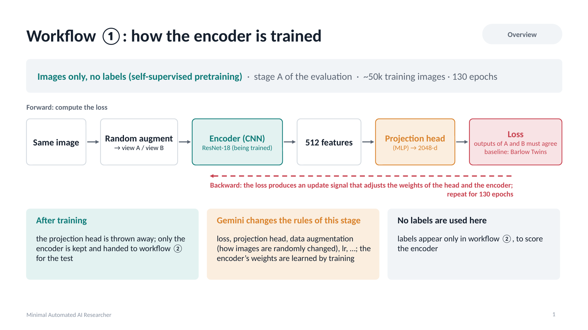
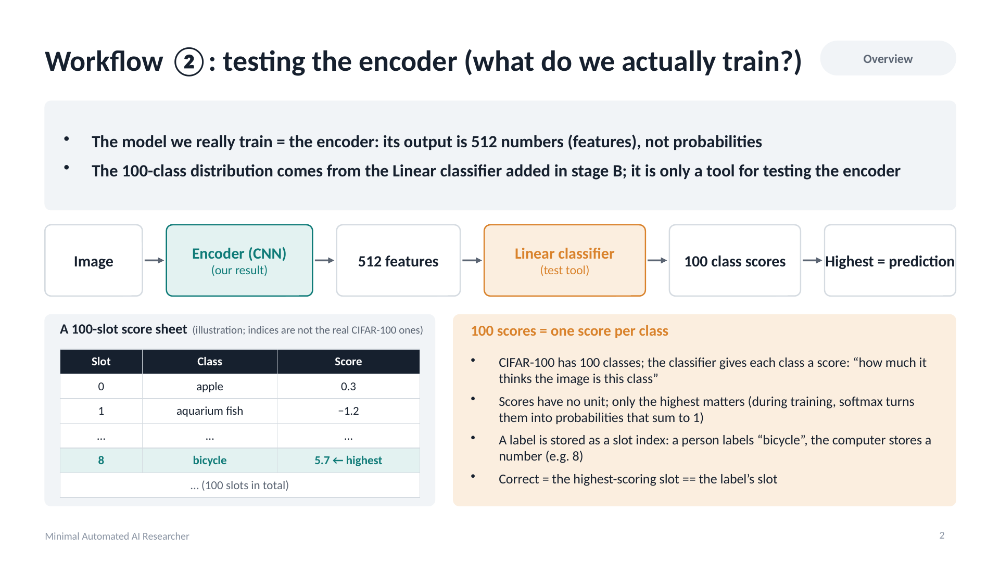
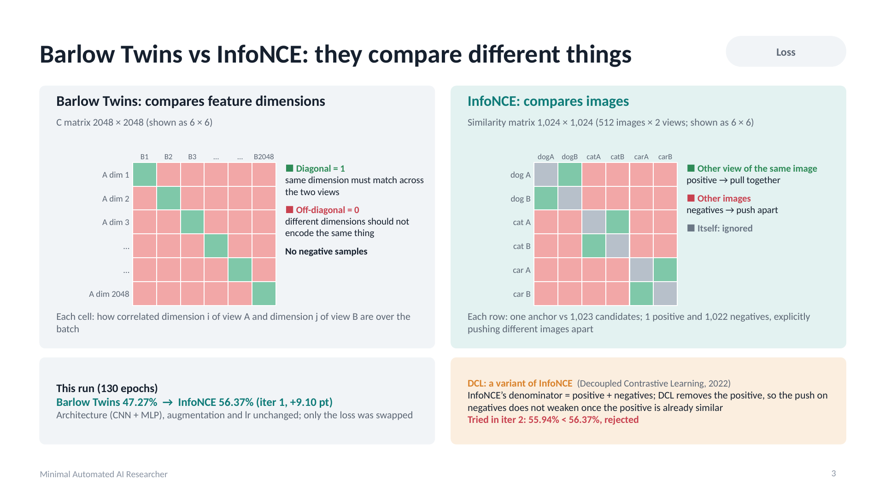
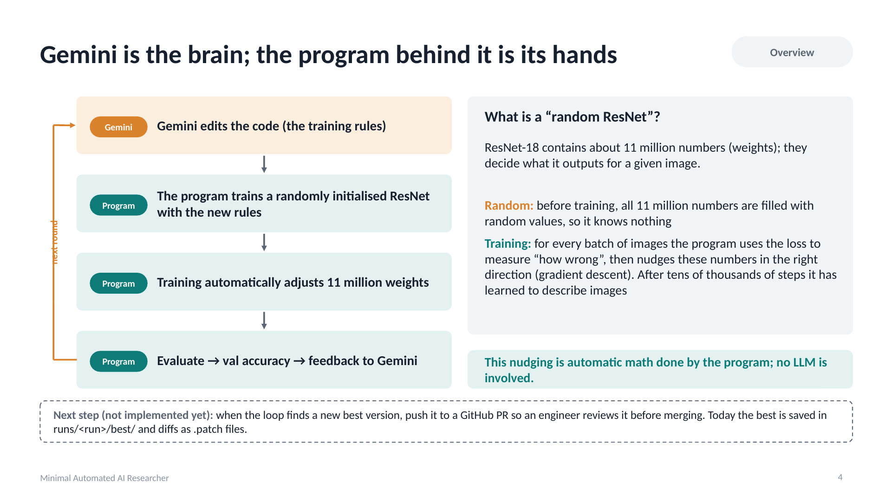
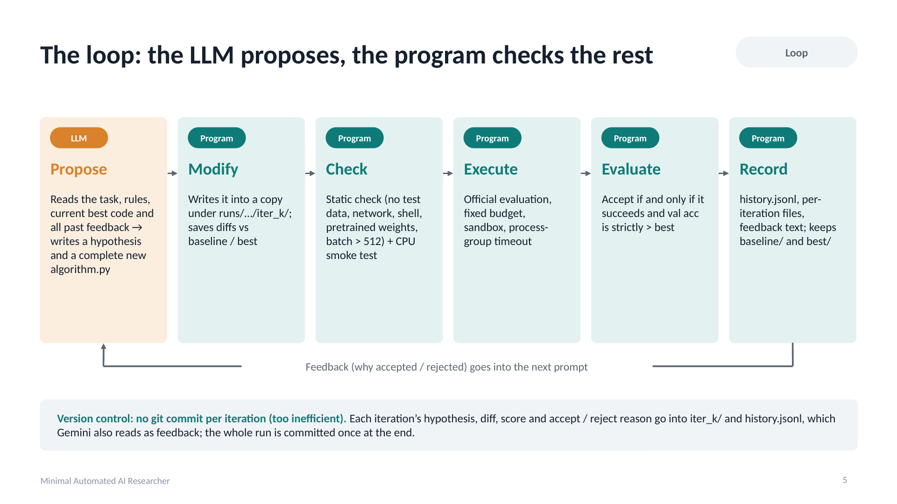
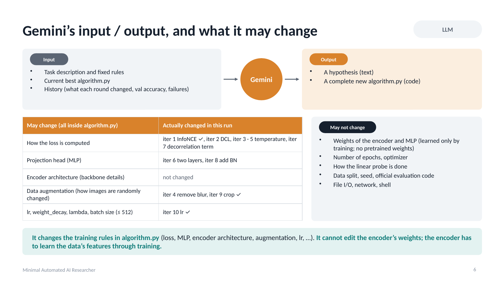
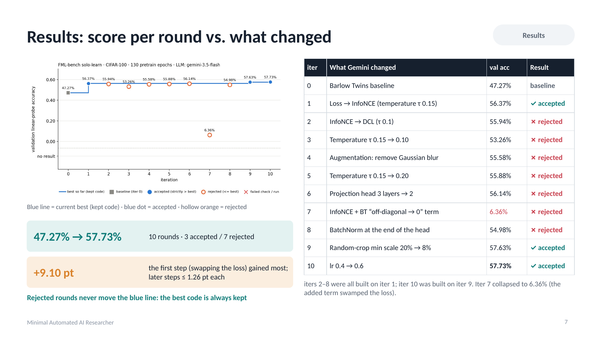

# Minimal automated AI researcher

> **🔎 Review page — every iteration of the main run on one page**
> (130 epochs, 10 iterations, val acc 47.27% → 57.73%: what Gemini changed, code diff, loss curve, automatic integrity checks, one-line verdict)
>
> - **[Open in browser (GitHub Pages)](https://peterchang1023.github.io/minimal-automated-AI-researcher/)** · mirror: [raw.githack](https://raw.githack.com/PeterChang1023/minimal-automated-AI-researcher/main/docs/index.html)
> - **[Review version with comments (claude.ai)](https://claude.ai/artifact/GkiyZuzH6zFeeQbPqPShpX)** — line comments, replies, and agree / doubt / more-seeds verdicts per iteration
> - Source: [`docs/index.html`](docs/index.html) (same file as [`runs/flash35-e130-10iter/viz/review.html`](runs/flash35-e130-10iter/viz/review.html)); rebuild with
>   `python scripts/build_review_page.py runs/flash35-e130-10iter --out docs/index.html`
>
> **🧪 Experimental explore run (not the main result)** — same loop and budget, only the Gemini prompt changed
> (`--prompt-variant explore`: no "minimal change" guidance; lists other SSL methods / encoder changes; reports time used per run).
> 46.77% → 61.44% after 10 iterations, mostly via a bigger backbone (see the disclosure).
> Continued to 20 iterations (`runs/flash35-e130-20iter-explore`, 120-min per-run limit): → **69.22%**,
> but part of that gain comes from concatenating multi-stage features, which enlarges the linear-probe input (baseline 512-d → 4032-d)
> — allowed by the rules, but not a like-for-like comparison ([20-iter disclosure](runs/flash35-e130-20iter-explore/DISCLOSURE.md)).
> [Review page, 20 iters (GitHub Pages)](https://peterchang1023.github.io/minimal-automated-AI-researcher/explore/) ·
> [with comments (claude.ai)](https://claude.ai/artifact/FgAX3Z9UiLtA2iZprvLsuj) ·
> [disclosure](runs/flash35-e130-10iter-explore/DISCLOSURE.md) · width ablation: [`runs/flash35-e130-10iter-explore_ablation_width1x`](runs/flash35-e130-10iter-explore_ablation_width1x/result.json)

**What this is.** An automated research loop for the FML-bench *solo-learn* task (self-supervised learning on CIFAR-100).
Gemini proposes one change to the training code per round; the program checks it, trains with a fixed 130-epoch budget,
scores it on a fixed validation split and keeps it only if it beats the current best. Over 10 rounds the validation
linear-probe accuracy went from **47.27 %** (official Barlow Twins baseline; upstream reports 47.77 %) to **57.73 %**.

## The project in 7 slides

<details open>
<summary>Click to collapse · <a href="docs/slides/key_slides_en.pptx">download as .pptx</a></summary>

**1. Workflow ① — train the encoder without labels**


**2. Workflow ② — score the encoder with a linear probe**


**3. Barlow Twins vs InfoNCE — the loss swap behind the biggest gain**


**4. Gemini is the brain, the program is its hands**


**5. The research loop — the LLM proposes, the program checks the rest**


**6. What Gemini may and may not change**


**7. Results — 47.27% → 57.73% in 10 rounds**


</details>

## Quick start

```bash
conda env create -f environment.yml && conda activate air        # full setup notes: docs/DETAILS.md §1
export GEMINI_API_KEY=...                                          # AI Studio key

# baseline only (official Barlow Twins, fixed budget)
python -m air.loop --run-name baseline --baseline-only --pretrain-epochs 130

# main result: 130 epochs, 10 Gemini iterations (+ one proposal for round 11, not executed)
python -m air.loop --run-name flash35-e130-10iter --backend gemini --model gemini-3.5-flash \
    --pretrain-epochs 130 --max-iters 10 --propose-next --timeout-min 60

# visualise the real logs
python scripts/visualize.py runs/flash35-e130-10iter                       # progress.png, trace.html
python scripts/build_review_page.py runs/flash35-e130-10iter --out docs/index.html   # review page

# pipeline test without GPU or API key (accuracies are FAKE and marked as such)
python -m air.loop --run-name pipeline-test --backend mock --fake-executor --max-iters 3 --propose-next \
    --data-root /tmp/air-data --work-root /tmp/air-work
```

Every command is resumable from `runs/<name>/history.jsonl`. All runs, per-iteration logs and figures are in
[`runs/`](runs/); the exam requirement → file map is [`docs/EXAM_MAPPING.md`](docs/EXAM_MAPPING.md).

## More details

[**docs/DETAILS.md**](docs/DETAILS.md): how it works step by step, setup on the GPU server, every command,
what is fixed so numbers are comparable, run-directory layout, and the full results of all three runs
(per-iteration tables, seed check, 50-epoch pilot, limitations).

## Disclosure

* **LLM used by the loop**: Google Gemini, model id logged per iteration in `history.jsonl`. All accepted
  candidates (both runs) and the next proposals came from `gemini-3.5-flash` via the free AI Studio API. Pro models were
  attempted first but were unavailable on the free tier (404 / quota 0), and a Google-account login of the
  Gemini CLI could not be completed on the server; those attempts are iterations 1–3.
* **LLM used to write this repository**: Claude (Anthropic) via Claude Code, with the author reviewing.
* **Manual interventions**: none in the loop logic or in any proposal. Between iterations the author changed
  the LLM backend/model on the command line and fixed the harness (Gemini CLI trust flag, Ctrl-C cleanup);
  these commits are in git history and did not change the evaluation or the budget fingerprint. Any hand-written proposal must go through
  `--backend file --response-file ...`, which is logged as `backend: file` in the history.
* **Failures**: every failed proposal (parse error, static check, smoke test, crash,
  timeout) is kept in `history.jsonl` and shown in the visualization.
* **Runs**: main result `runs/flash35-e130-10iter` (130 epochs, 10 iterations); 50-epoch pilot runs
  `runs/main` (first attempt, iterations 1–4 are LLM-setup failures) and
  `runs/flash35-clean` (fresh run after the setup was fixed). Neither log was edited; the clean run
  was started as a new run instead of deleting failures from the old one.
* **Known limitation**: one seed per candidate on a 3,021-image validation set; the
  standard error of an accuracy near 45 % is about ±0.9 pts, so the strict
  "higher is better" rule can accept noise. See the limitation slide.
