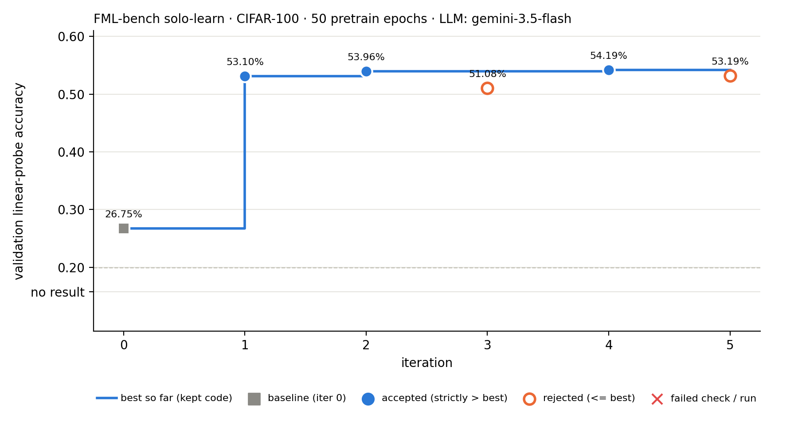
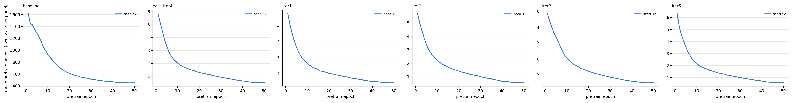
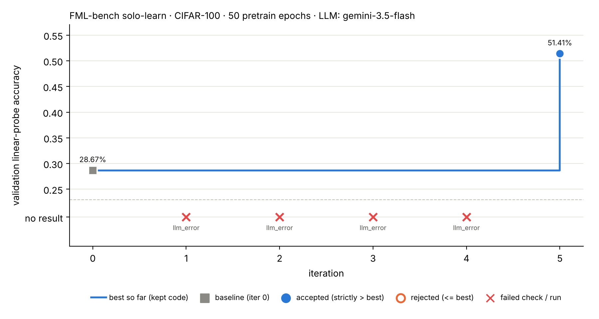

# Minimal automated AI researcher

See [`docs/EXAM_MAPPING.md`](docs/EXAM_MAPPING.md) for where each exam requirement is answered.

A small, auditable **Propose → Modify → Execute → Evaluate → Record** loop on the
FML-bench task **`Representation_Learning_solo_learn`** (Barlow Twins, ResNet-18,
CIFAR-100, linear-probe evaluation). An LLM proposes one hypothesis per iteration and
rewrites a *copy* of `algorithm.py`; everything else (checks, training, evaluation,
the accept/reject decision, the feedback text) is deterministic program code.

| | |
|---|---|
| Benchmark | [FML-bench](https://github.com/qrzou/FML-bench) @ `d336651`, task files vendored in [`fmlbench_task/`](fmlbench_task/UPSTREAM.md) (byte-identical, SHA-256 pinned) |
| Metric | `linear_eval_acc_mean` on the validation split, higher is better. Upstream full-budget (130 epochs) val = **47.77 %** |
| Our budget | **50 pretrain epochs** (shortened from 130), everything else as upstream. Change with `--pretrain-epochs` (it starts a new, separately comparable run) |
| LLM | Gemini via Google AI Studio REST (`GEMINI_API_KEY`), default model `gemini-3.1-pro-preview` (`--model`/`GEMINI_MODEL`). Pluggable: `--backend gemini-cli` (Google `gemini` CLI logged in with a Google account, uses the subscription quota), `claude-cli`, `file`, `mock` |
| Libraries | PyTorch 2.1.0 (cu121), torchvision 0.16.0, NumPy 1.26.4, Pillow, matplotlib. Python stdlib only for the loop / LLM client (no SDK, no RAG) |

## Result at a glance (`runs/flash35-clean`, 5 Gemini iterations)



Baseline 26.75 % → best **54.19 %** (iter 4) after 5 real `gemini-3.5-flash` proposals (3 accepted,
2 rejected, 0 failures), 50 pretrain epochs, validation split. Details in [§4a](#4a-clean-run-runsflash35-clean-hinton-2026-11-14--main-result).
The first run (`runs/main`, whose iterations 1–4 were LLM-setup failures) is kept unchanged in [§4b](#4b-first-run-runsmain-hinton-2026-11-13).

## 1. Setup on hinton

```bash
# code lives in $HOME; data + checkpoints go to /cache/$USER (lab rule)
git clone https://github.com/PeterChang1023/minimal-automated-AI-researcher.git ~/minimal-automated-AI-researcher
cd ~/minimal-automated-AI-researcher
# keep download caches out of $HOME (lab rule: only code + packages in home)
export PIP_CACHE_DIR=/cache/$USER/pip CONDA_PKGS_DIRS=/cache/$USER/conda_pkgs TORCH_HOME=/cache/$USER/torch
mkdir -p $PIP_CACHE_DIR $CONDA_PKGS_DIRS $TORCH_HOME
conda env create -f environment.yml          # creates env "air"
conda activate air
bash scripts/env_info.sh                     # records GPU / driver / torch for the report
bash scripts/prepare_data.sh                 # CIFAR-100 -> /cache/$USER/air/data
export GEMINI_API_KEY=...                    # typed in your shell only; never committed
python -m air.llm                            # lists Gemini models your key can use (sanity check)
```

The GPU is shared, so pin one device and keep the default batch size (512, same as
upstream; estimated 10–15 GB of GPU memory, not yet measured):

```bash
export CUDA_VISIBLE_DEVICES=0
```

## 2. Commands

Run inside `tmux` (each experiment is ~10–20 min). If tmux is missing, install it into the env without root: `conda install -n air -c conda-forge tmux -y`. Every command is resumable: if it
dies, re-run the same line and it continues from `runs/<name>/history.jsonl`.

```bash
# Part 1 – baseline only, shortened budget
python -m air.loop --run-name main --baseline-only

# Part 2 – clean 5-iteration run used for the results (section 4a)
python -m air.loop --run-name flash35-clean --backend gemini --model gemini-3.5-flash --max-iters 5 --propose-next

# Part 2 – one LLM candidate (+ the next proposal, generated from the feedback, not executed)
python -m air.loop --run-name main --max-iters 1 --propose-next

# more iterations later (same run, same budget -> comparable)
python -m air.loop --run-name main --max-iters 5 --propose-next

# Seed robustness check (outside the selection loop): baseline + best code with extra seeds
python scripts/seed_check.py runs/main --seeds 1 2   # ~4 x 7 min -> runs/main/seed_check/summary.json
python scripts/plot_loss_curves.py runs/main         # per-epoch pretraining loss -> runs/main/viz/loss_curves.png

# Part 3 – visualization from the real logs
python scripts/visualize.py runs/flash35-clean   # -> runs/flash35-clean/viz/progress.png, trace.html
python scripts/plot_loss_curves.py runs/flash35-clean

# when finished (lab rule): remove data + checkpoints, keep logs
bash scripts/cleanup_cache.sh
rm -rf /cache/$USER/pip /cache/$USER/conda_pkgs /cache/$USER/torch
```

Pipeline test without GPU or API key (random accuracies, clearly marked as FAKE in all outputs):

```bash
python -m air.loop --run-name pipeline-test --backend mock --fake-executor --max-iters 3 --propose-next \
    --data-root /tmp/air-data --work-root /tmp/air-work
python scripts/visualize.py runs/pipeline-test
```

Useful flags: `--timeout-min 40`, `--max-hours 12`, `--max-consecutive-failures 3`,
`--max-batch-size 512`, `--keep-ckpt`, `--model gemini-3.1-pro-preview`. The API free tier may have zero quota for Pro models (HTTP 429 `limit: 0`); then use `--backend gemini-cli` or a billed key.

## 3. How one iteration works

| step | who | what |
|---|---|---|
| Propose | **LLM** | Prompt = task + fixed rules + current best `algorithm.py` (full) + every past attempt's hypothesis, status, val acc, decision and feedback ([`air/prompts.py`](air/prompts.py)). Reply = JSON (`hypothesis`, `rationale`, `expected_effect`, `change_summary`) + the complete new `algorithm.py`. |
| Modify | program | Written to `runs/<run>/iter_k/algorithm.py` (a copy). The upstream baseline in `fmlbench_task/` is never edited; diffs vs best and vs baseline are saved. |
| Check | program | Static checks ([`air/checks.py`](air/checks.py)): required functions, no data loading / test-split / result-file references, no network, shell, file I/O or pretrained weights, batch size ≤ cap. Then a CPU smoke test ([`air/smoke_check.py`](air/smoke_check.py)) of exactly the interface the official script uses. Failing candidates never reach the GPU. |
| Execute | program | Fresh sandbox under `/cache/$USER/air/work/<run>/iter_k/` with the candidate + the **unchanged** `train_eval_baseline.py` + fixed `split_config.json`. [`air/eval_wrapper.py`](air/eval_wrapper.py) overrides only the budget/protocol keys of `get_training_config()` and calls the official `main()` with `--split val`. Own process group, hard timeout. |
| Evaluate | program | Accept **iff** the run finished, produced a finite metric, and `val_acc > best_val_acc` (strict). Otherwise the best code stays. |
| Record | program | `history.jsonl` (one line per iteration) + `iter_k/` artifacts; the feedback sentence is what the LLM sees next time. `best/algorithm.py` always holds the best valid code, `baseline/algorithm.py` the original. |

### What is fixed (so numbers are comparable)

* **Evaluation**: `train_eval_baseline.py` is SHA-256 checked before every run; the linear
  probe protocol (100 epochs, lr 0.1, batch 256, seed 100) is forced by the wrapper.
* **Split**: `split_config.json` (val_ratio 0.057 → 3,021 val images, seed 42) is fixed;
  the LLM may not change it (upstream allows it, we don't, because a different split makes accuracies incomparable).
* **Seeds**: `set_seed(42)` in the official script; linear probe seed 100.
* **Budget**: `pretrain_epochs`, batch-size cap and timeout are part of the run
  fingerprint in `run_config.json`; resuming with a different budget is refused.
* **Test labels**: the loop only ever runs `--split val`. The hidden test split
  (7,000 images) is never evaluated by the loop, so it cannot influence selection.

### Run directory layout

```
runs/<run>/
  run_config.json          budget, seeds, fingerprint, LLM, hardware, argv (+ resumes)
  history.jsonl            one record per iteration (the source for the visualization)
  baseline/algorithm.py    original code          best/algorithm.py + meta.json  best valid code
  iter_k/loss_curve.json   mean pretraining loss of every epoch (runs after 2026-11-13 23:30)
  iter_000/                baseline: algorithm.py, smoke.log, stdout.log, val_info.json, record.json
  iter_001/                prompt_system.txt, prompt_user.txt, llm_response.txt, proposal.json,
                           algorithm.py, diff_vs_best.patch, diff_vs_baseline.patch,
                           smoke.log, stdout.log, effective_config.json, val_info.json, record.json
  next_proposal/           the proposal made from all feedback, not executed
  viz/                     progress.png, trace.html
```

## 4. Results

### 4a. Clean run `runs/flash35-clean` (hinton, 2026-11-14) — main result

A fresh run made after the LLM setup was fixed, so every iteration is a real Gemini proposal.
`runs/main` (4b below) is kept untouched as the honest record of the first attempt, including its
setup failures. Same budget fingerprint as `runs/main` (50 pretrain epochs, eval/split SHA-256 identical).

```bash
python -m air.loop --run-name flash35-clean --backend gemini --model gemini-3.5-flash --max-iters 5 --propose-next
python scripts/visualize.py runs/flash35-clean && python scripts/plot_loss_curves.py runs/flash35-clean
```

**Progress** (validation accuracy per iteration; line = best code kept so far):


**Per-epoch pretraining loss** (one panel per code version, each with its own y-scale):



**Step-by-step trace** (each iteration's hypothesis, checks, result and decision; LLM vs program stages colour-coded):
[open in browser](https://htmlpreview.github.io/?https://github.com/PeterChang1023/minimal-automated-AI-researcher/blob/main/runs/flash35-clean/viz/trace.html) · [source](runs/flash35-clean/viz/trace.html)
(GitHub shows `.html` files as source code, so use the first link or open the file locally).
Full console log: [`runs/flash35-clean.log`](runs/flash35-clean.log).

| iter | what the LLM changed (vs current best) | val acc | Δ vs best | decision |
|---|---|---|---|---|
| 0 | unmodified Barlow Twins baseline | **26.75 %** | – | baseline |
| 1 | Barlow Twins loss → NT-Xent (SimCLR), τ = 0.1; drop Gaussian blur; crop scale 0.08–1; lr 0.4 → 0.5 | **53.10 %** | +26.35 | accepted |
| 2 | NT-Xent → Decoupled Contrastive Learning (DCL) loss | **53.96 %** | +0.86 | accepted |
| 3 | τ 0.1 → 0.07 and crop scale 0.08 → 0.2 | 51.08 % | −2.88 | rejected |
| 4 | projection head 3 → 2 layers | **54.19 %** | +0.23 | accepted (best) |
| 5 | add BatchNorm after the last projection layer | 53.19 % | −0.99 | rejected |
| next | DCL → DCLW (weighted negatives), **not executed** | – | – | – |

All 6 experiments finished (no LLM, check or runtime failures; ~6–7 min each, ≈ 37 min total).
Best: iter 4, 54.19 % on the val split, vs 47.04 % for the 130-epoch baseline in our environment.
Reviewed by the author: the diffs change only loss, projection head, augmentation and the
pretraining lr; backbone, 512-d features and the linear-probe protocol are untouched
(`effective_config.json`).

**How to read it.** Iter 1 is a large, robust gain (≈ 20× the seed noise measured in 4b) but it changed
four things at once, so it is not attributable to one of them. Iters 2 and 4 were accepted by the
strict single-seed `>` rule with +0.86 and +0.23 pts — *smaller* than the seed-to-seed spread we
measured (sd 0.36–1.21 pts) and than the val-set standard error (≈ ±0.9 pts). They may be real, but
this run cannot tell; that is exactly the noise problem Part 4 addresses. The baseline itself came out
at 26.75 % here vs 28.67 % in `runs/main` with the same code and seed 42, which is GPU
non-determinism of the same size as the seed spread (26.55–28.67 %).

### 4b. First run `runs/main` (hinton, 2026-11-13)

First attempt, kept as the honest failure log (iterations 1–4 = LLM setup errors, not research results):



Trace: [open in browser](https://htmlpreview.github.io/?https://github.com/PeterChang1023/minimal-automated-AI-researcher/blob/main/runs/main/viz/trace.html) · [source](runs/main/viz/trace.html).

| run | iter | what | LLM | pretrain epochs | val acc | wall time | decision |
|---|---|---|---|---|---|---|---|
| upstream (reported) | – | Barlow Twins baseline | – | 130 | 47.77 % | – | – |
| [full130](runs/full130/) | 0 | Barlow Twins baseline, unmodified, **full upstream budget** (reproduction check) | – | 130 | **47.04 %** | 1,070 s | baseline |
| main | 0 | Barlow Twins baseline, unmodified | – | 50 | **28.67 %** | 430 s | baseline |
| main | 1 | LLM call failed: model closed to new users (HTTP 404) | gemini-2.5-pro | 50 | – | – | rejected |
| main | 2 | LLM call failed: Gemini CLI refused untrusted folder (fixed in harness) | gemini-3.1-pro-preview | 50 | – | – | rejected |
| main | 3 | LLM call failed: free-tier quota is 0 for this model (HTTP 429) | gemini-3.1-pro-preview | 50 | – | – | rejected |
| main | 4 | LLM call failed: model overloaded (HTTP 503 after 5 retries) | gemini-3.8-flash | 50 | – | – | rejected |
| main | 5 | InfoNCE (SimCLR) loss, τ = 0.2, inside `BarlowTwinsLoss`; lr 0.4 → 0.5 | gemini-3.5-flash | 50 | **51.41 %** | 430 s | **accepted** (+22.74 pts) |
| main | next | lower InfoNCE temperature 0.2 → 0.1 (generated from iter-5 feedback, **not executed**) | gemini-3.5-flash | – | – | – | – |

**Reproduction check.** With the upstream 130-epoch budget our environment gives 47.04 % vs the
reported 47.77 % (−0.73 pts, within the ≈ ±0.9 pt standard error of a 3,021-image val set), so the
harness and environment reproduce the official baseline. `full130` was run with `python -m air.loop --run-name full130 --pretrain-epochs 130 --baseline-only`; its logs are in [`runs/full130/`](runs/full130/) (official stdout with loss every 20 epochs: [`iter_000/stdout.log`](runs/full130/iter_000/stdout.log); it predates per-epoch loss logging, so there is no `loss_curve.json`) and [`runs/full130.log`](runs/full130.log). Note that the accepted 50-epoch candidate (51.41 %) beats the
130-epoch baseline at ~38 % of the pretraining compute (validation split only; not a test-set claim).

Reproduce: `python -m air.loop --run-name main --baseline-only`, then
`python -m air.loop --run-name main --max-iters 5 --propose-next --backend gemini --model gemini-3.5-flash`.
Iterations 1–4 are infrastructure failures, kept on purpose: they show the loop recording
an LLM failure as a rejected iteration without executing anything or touching the best code.

**Review of the accepted change (by the author, not the loop).** The diff
([`runs/main/iter_005/diff_vs_baseline.patch`](runs/main/iter_005/diff_vs_baseline.patch)) leaves the backbone,
feature dimension (512), augmentation and evaluation untouched; `effective_config.json` confirms the
linear-probe protocol was forced to the official values. Pretraining loss fell 5.48 → 3.16
(chance ≈ ln 1023 ≈ 6.9). Caveats: the LLM changed two things at once (loss and lr), so the gain
cannot be attributed to either; one seed; val set of 3,021 images (SE ≈ ±0.9 pts). The gap is far
larger than that noise, but the result is a single comparison, not an ablation.

**Seed robustness check** (`scripts/seed_check.py`, outside the selection loop; only the global
pretraining seed changes, split and linear-probe seeds fixed; 50 epochs):

| code | seed 42 | seed 1 | seed 2 | mean ± sd |
|---|---|---|---|---|
| baseline (Barlow Twins) | 28.67 % | 26.55 % | 28.63 % | **27.95 ± 1.21 %** |
| best (iter 5, InfoNCE τ=0.2, lr 0.5) | 51.41 % | 52.07 % | 51.51 % | **51.66 ± 0.36 %** |

Per-epoch pretraining loss for these reruns: [`runs/main/viz/loss_curves.png`](runs/main/viz/loss_curves.png) (each panel its own y-scale; Barlow Twins ≈ 1,800 → 470, InfoNCE ≈ 5.5 → 3.1; seeds overlap closely).

The gain (+23.7 pts on the means) is ~20× the larger seed-to-seed sd, so iter 5's acceptance is not
seed luck. The baseline's seed-to-seed spread (26.55–28.67 %, ~2 pts) also shows that the loop's
single-seed strict-`>` rule *would* be able to accept a 1–2 pt "improvement" that is pure noise —
the main limitation addressed in Part 4.

Hardware: hinton, 1× NVIDIA H100 NVL (95,830 MiB, shared; ~12.6 GB used by others), driver 590.48.01;
AMD EPYC 9124 (32 threads), 377 GB RAM; Python 3.10.22, torch 2.1.0+cu121, torchvision 0.16.0, cuDNN 8.9.2.
Exact strings in `runs/main/run_config.json`. Budget: 50 pretrain epochs ≈ 7 min per experiment.

## 5. Disclosure

* **LLM used by the loop**: Google Gemini, model id logged per iteration in `history.jsonl`. All accepted
  candidates (both runs) and the next proposals came from `gemini-3.5-flash` via the free AI Studio API. Pro models were
  attempted first but were unavailable on the free tier (404 / quota 0), and a Google-account login of the
  Gemini CLI could not be completed on the server; those attempts are iterations 1–3.
* **LLM used to write this repository**: Claude (Anthropic) via Claude Code, with the author reviewing.
* **Manual interventions**: none in the loop logic or in any proposal. Between iterations the author changed
  the LLM backend/model on the command line and fixed the harness (Gemini CLI trust flag, Ctrl-C cleanup);
  these commits are in git history and did not change the evaluation or the budget fingerprint. Any hand-written proposal must go through
  `--backend file --response-file ...`, which is logged as `backend: file` in the history.
* **Failures**: every failed proposal (parse error, static check, smoke test, crash,
  timeout) is kept in `history.jsonl` and shown in the visualization.
* **Two runs**: `runs/main` (first attempt, iterations 1–4 are LLM-setup failures) and
  `runs/flash35-clean` (fresh run after the setup was fixed). Neither log was edited; the clean run
  was started as a new run instead of deleting failures from the old one.
* **Known limitation**: one seed per candidate on a 3,021-image validation set; the
  standard error of an accuracy near 45 % is about ±0.9 pts, so the strict
  "higher is better" rule can accept noise. See the limitation slide.
